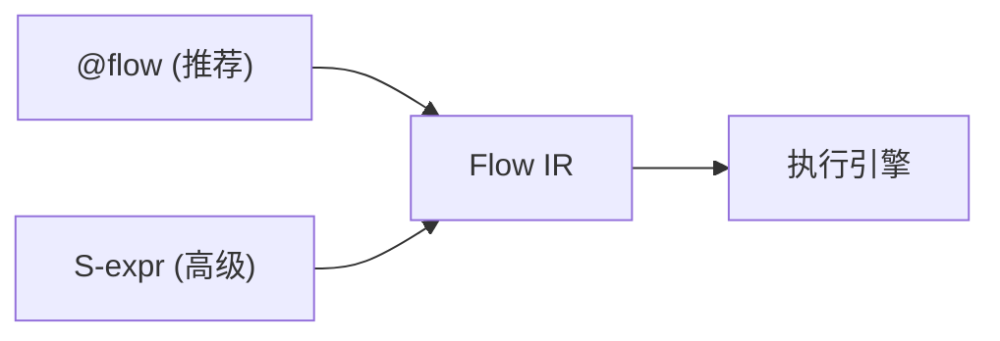

# @flow DSL

`@flow` 是 plaita 的**首选 Python API**，它把普通函数体通过 `ast` 编译为 Flow IR，表达式用真实 Python 语法，IDE 补全最好，AI 生成最友好。



!!! tip "AI Agent 场景"

    `@flow` + [`flow_from_source`](#flow_from_source) 最适合 LLM 运行期生成流程（编译期校验 + 无源文件依赖）。端到端场景见 [应用场景 - Agent 编排](../scenarios/agent-orchestration.md)。

!!! tip "写业务 flow 前先读编写规范"

    语法之外还有一组**编译期不拦**的作者约束（跨分支同名赋值禁止、集合子流程作用域边界、`params=` 运行语义）与业务集成知识（plaita-nodes 节点激活、业务 flow 项目结构、发布 console 的 worker 节点注入）。权威单源：`plaita-ai/plaita_ai/skills/flow-coder/references/authoring-spec.md`；skill 安装见 [AI 与 Skill](../ai/skills.md)。

---

## AST Python DSL（`@flow`）

`plaita.dsl.codeflow` 是「极致」形态：用户写一个普通 Python 函数，`@flow` 用 `ast` 解析函数体，把 `if`/`for`/`return`/赋值翻译成 flow 节点，把 `INPUT.age >= 18` 编译成 `$INPUT.age` 表达式串。**函数体从不被当作 Python 执行**——它只是一段被静态分析的语法树。

```python
from plaita.dsl.codeflow import flow, F, NODE, MAP, HTTP, ErrorHandler

@flow("create_user", desc="创建用户")
def create_user(INPUT):
    if INPUT.age >= 18:
        resp = HTTP.post(
            url="https://api.example.com/users",
            body={"name": INPUT.name},
            timeout="PT5S",
            on_error=ErrorHandler("continue_with", default={"data": None}),
        )
        return resp.data
    return "未成年"

create_user.run(name="alice", age=20)
```

关键点：

- **写起来就是纯 Python**：有补全、有类型、写错编译期就报。
- **`INPUT` / `F` / `HTTP` 这些名字不需要 import**——它们在函数体里只是语法占位，AST 编译期被识别，运行期不会真正查这几个名字（可选 import 仅用于 IDE 提示）。
- **编译产物仍是 `Flow` IR**，与 JSON/YAML/Builder 完全等价。

!!! note "input_type / output_type 已废弃"

    `@flow` / `@childflow` 的 `input_type` / `output_type` 参数**已废弃且被忽略**：`$INPUT` 恒为 `run()` 传入的 dict，无需声明。示例统一写作 `@flow("id")`；旧代码里写了也会被忽略（`flow_from_source` 路径发 `DeprecationWarning`，直接装饰器调用会 `TypeError`）。

### 表达式映射

| 你写的 Python | 编译成的表达式串 |
|----------------|-------------------|
| `INPUT.age` | `$INPUT.age` |
| `F.upper(INPUT.name)` | `$F.upper($INPUT.name)` |
| `resp.data` | `$NODE.resp.data` |
| `INPUT.items[0]` | `$INPUT.items[0]` |
| `a + b` / `a - b` / `a * b` / `a % b` | `$F.add(a,b)` / `$F.sub` / `$F.mul` / `$F.mod` |
| `len(x)` / `abs(x)` | `$F.len(x)` / `$F.abs(x)` |
| `if a >= 18 and b == 1:` | 条件组 `{relation: and, ...}` |
| `if not (x == "blocked"):` | 取反 `{relation: not, ...}` |

> 比较与 `and`/`or`/`not` 只能出现在 `if` 判断位置；算术 `+ - * / %` 编译成 `$F.add/sub/mul/div/mod`（表达式语言没有中缀运算符）。

### 表达式语义边界

`@flow` 用 Python 语法做皮、子集做骨：函数体**不被当 Python 执行**，只走静态 AST 编译。能编译的写法与精确语义如下，**写法不在表里就会在构建 `Flow` 前报错（带行号与重写提示）**。

**支持的 Python 表达式**

| 写法 | 编译产物 | 精确语义 |
|------|----------|----------|
| 字面量 `1` `"x"` `True` `None` `[1,2]` `{"a":1}` | 原值 | 原样；dict key 必须是常量 |
| `INPUT.x` / `NODE.r.data` / `GLOBAL.k` / `PARENT.x` / `ENV.K` | `$INPUT.x` / `$NODE.r.data` / … | 命名空间变量解析 |
| `obj.path[0]` / `obj.path[-1]` | `$obj.path[0]` / `$obj.path[-1]` | 仅整数常量下标 |
| `F.foo(a, b)` | `$F.foo(a, b)` | 调用注册的表达式函数 |
| `len(x)` / `abs(x)` / `round(x)` | `$F.len` / `$F.abs` / `$F.round` | 映射到**真 Python 内置**, 语义精确 |
| `str(x)` | `$F.concat(x)` | **近似映射**: `concat` = `"".join(str(a) for a in args)`, 单参时与 `str()` 等价; `str` 当类型转换的意图被实现成"拼成字符串" |
| `a + b` `a - b` `a * b` `a / b` `a % b` `a ** b` | `$F.add/sub/mul/div/mod/pow` | 直接对应 Python 运算符 (`a + b`), 因此 `+` 对 int/str/list 都按 Python `+` 多态——**类型决定语义, 编译期不做类型检查** |
| `a == b` `!=` `>` `>=` `<` `<=` `in` `not in` | `$F.eq/ne/gt/gte/lt/lte/in/notIn(…)` | 表达式位置的比较落到注册表同名比较函数（函数名与 `if` 条件算子一致）；链式比较 `a < b < c` 编译为 `$F.and($F.lt(a,b), $F.lt(b,c))` |
| `a and b` / `a or b` / `not x` | `$F.and(…)` / `$F.or(…)` / `$F.not(…)` | 表达式位置的布尔运算。`or` 返回第一个真值（Python 真值语义）；`and` 链按 Python 结合律左折叠嵌套。均**急切求值**（无短路），`$F` 函数皆纯故无副作用 |
| `a if c else b` | `$F.ifelse(c, a, b)` | 三元。急切求值：两支都会被求值 |

**不支持、会报错的 Python 写法（含重写提示）**

| 写法 | 报错提示 |
|------|----------|
| f-string `f"hi {name}"` | 用 `F.concat('hi ', INPUT.name)` |
| 列表/集合/字典推导式 | 用 `MAP`/`FILTER` 节点 |
| `lambda` / `await` / 海象 `:=` / `*args` 解包 | 不支持, 拆成节点或普通赋值 |
| 字面量方法调用 `"x".upper()` / 任意非 `F.*` 非 `len/abs/round/str` 调用 | 表达式里只能调 `F.xxx(...)` 或上述内置 |
| 集合字面量 `{1,2}` | 用列表 |

> **关于 `+` 的多态陷阱**：`name + "!"` 编译成 `$F.add($INPUT.name, "!")`，运行时 `+` 对字符串是拼接、对数字是加——结果**取决于运行时类型**, 编译期不拦。若要强制字符串拼接且对非字符串报错, 显式用 `F.concat(...)`。

### if / elif / else、return、赋值

```python
@flow("grade")
def grade(INPUT):
    if INPUT.score >= 90:
        return "A"
    elif INPUT.score >= 60:
        return "B"
    else:
        return "C"

grade.run(score=95)   # -> "A"
```

赋值会生成 `assignment` 节点，后续用变量名引用其输出：

```python
@flow("greet")
def greet(INPUT):
    name = F.upper(INPUT.name)
    return F.concat("hi ", name)

greet.run(name="alice")   # -> "hi ALICE"
# name = $F.upper($INPUT.name);  return = $F.concat("hi ", $NODE.name)
```

### `end(...)`：error / nop 结束出口 { #end-statement }

`return` 恒定产出 `resultType="success"` 的 end 节点。要以业务错误结束（引擎抛
`FlowResultError`，外层得到 `FlowExecutionException(error_type=ERROR_RESULT)`）或
静默结束（`nop`）时，用 `end(...)` 终止语句——与 `return` 同级（之后语句不可达），
差别是能显式声明 `result_type` 与 `error` 载荷：

```python
@flow("create_user")
def create_user(INPUT):
    if INPUT.age >= 18:
        return "ok"
    end(result_type="error", error={"code": 4001, "message": "参数非法"})

create_user.run(age=17)   # -> 抛 FlowExecutionException(error_type=ERROR_RESULT)
```

- 参数：`output=`（可选，也可作唯一位置参数）、`result_type=`（`"success"` 默认 /
  `"error"` / `"nop"`，须为字符串字面量）、`error=`（dict 字面量，习惯写
  `{"code": ..., "message": ...}`）。
- `result_type=` 的**取值域是小写 `success`/`error`/`nop`**（发动机口径，大小写敏感）：
  `"bogus"`、`"ERROR"` 等域外值**编译期硬错**，不会被静默降级成 `success`。
- `error=` 是**纯字面数据**，引擎从不求值它（`End.execute` 直接 `self.error.get(...)`）：
  含字面 `$` 的字符串/键名（如 `{"message": "$100 fee missing"}`、`{"$ref": "x"}`）
  原样保留、不参与表达式编译；写成表达式（如 `{"message": INPUT.msg}`）会在编译期报错。
  它也**不参与 `$NODE`/`$F` 引用扫描**——载荷里写 `"$NODE.e"` 只是文本，不会被判悬空引用。
- `end(...)` 是语句形态而非占位符，**无需 import**（`@flow` 函数体只被静态解析、
  从不执行）；`result_type="nop"` 时流程静默结束并丢弃 `output`。

### 集合节点

`map` / `filter` / `find` / `loop` 用 `for x in MAP(...)` 语法，子流程直接写在函数体里：

```python
@flow("double_numbers")
def double_numbers(INPUT):
    for x in MAP(INPUT.numbers, id="dbl"):
        return F.mul(x, 2)
    return NODE.dbl

double_numbers.run(numbers=[1, 2, 3, 4])   # -> [2, 4, 6, 8]
```

`filter` / `find` 的子流程需要返回 bool，惯例是 `if ... return True` / `return False`：

```python
@flow("first_even")
def first_even(INPUT):
    for x in FIND(INPUT.nums, id="fd"):
        if F.mod(x, 2) == 0:
            return True
        return False
    return NODE.fd

first_even.run(nums=[1, 3, 4, 6])   # -> 4
```

**作用域**：循环体是子流程——循环目标名（`x` / `acc, it`）映射子流程输入；
外层已赋值变量自动映射为 `$PARENT.NODE.<名>` 快照引用（与 `while` 同一约定），
体内可读集合节点执行前已确定的父侧变量，**写不回父 context**。聚合语义用
`REDUCE`（累积值经 `return` 串联，结果经 `NODE.<id>` 引用）或对
`NODE.<集合节点id>`（`MAP` 的输出即结果列表）的下游表达式表达——不要试图在
集合子流程里引用集合节点自身的结果（父侧此刻尚未写回）。裸 `INPUT` 在体内指
子流程输入；要读外层原始输入须显式写 `PARENT.INPUT.<名>`。

循环**之后**，集合节点的 `id=` 同样进入名字作用域：上面的 `return NODE.dbl`
可直接写成 `return dbl`（解析为 `$NODE.dbl`）。`emit_source` 发射下游
`$NODE.<id>` 时用的正是这个裸名形态，因此 `IR → @flow → IR` 往返依赖它解析回
同一个引用（plaita#220-L1）。命名 WHILE 的 for-head（`for item in WHILE(...,
id="w")`）同理。

```python
@flow("scaled_sum")
def scaled_sum(INPUT):
    limit = F.mul(INPUT.base, 100)          # 外层赋值，体内可读
    for acc, it in REDUCE(INPUT.items, initial=[], id="rd"):
        return F.append(acc, F.mul(it, limit))
    return NODE.rd

scaled_sum.run(base=2, items=[1, 2, 3])     # -> [200, 400, 600]
```

### 子流程 @childflow + CHILD

`@childflow` 装饰一个子流程函数，父流程用 `CHILD(...)` 引用：

```python
from plaita.dsl.codeflow import flow, childflow, CHILD, F

@childflow()
def double_each(INPUT):
    return F.mul(INPUT.item, 2)

@flow("double_via_child")
def double_via_child(INPUT):
    r = CHILD(input={"item": INPUT.payload}, flow=double_each)
    return r

double_via_child.run(payload=21)   # -> 42
```

> `CHILD` 的 `input` 要与子流程的输入形态匹配：`$INPUT` 恒为 dict，`input` 就传 dict。

`@childflow` 与 `@flow` 同形制：**位置参数是子流程的 `flow_id`**，`desc` 是纯关键字参数（位置串永远是 id，不会被当成 `desc`）：

```python
@childflow("cf")                 # 位置 id -> 子流程 IR flow_id == "cf"
@childflow(desc="说明")           # 只有说明 -> flow_id is None（历史写法，行为不变）
@childflow("cf", desc="说明")     # 两者
@childflow()                     # 匿名 -> flow_id is None
```

> **`flow_id` 不参与节点寻址 / 查找**：`plaita/core/flow.py` 里它的引用全在日志与元数据路径上（5 处 `logger.warning`：`flow.py:178/250/281/311/343`，以及已废弃的 `Flow.id` 访问器与 IR 键归一化）。它不是路由键，也不是跨流程引用名（引用用源码函数名 `flow=<name>`）。
> **但它会被写进执行上下文，因此是可观测的**：`plaita/core/context.py:314` → `$GLOBAL.flow_id`；`context.py:331` / `state.py:632` → `$FLOW_ID`（别名 `$FLOW`）。实测（子 `end` 的 output 写 `$FLOW_ID`）：`@childflow("cf")` 得到 `'cf'`；**裸 `@childflow` 得到父流程的 id**（子作用域为 `None`，`context.py:137-148` 回落到父上下文）——所以**给不给 id 会改变 `$FLOW_ID` 的值，按它分支的表达式会走不同分支**。
> 不给 id 就是 `None`，**不回落函数名**——内联子流程没有可用函数名，回落会让同名子流程撞 id。
> `emit_source` → `compile_source` 往返保真这个值（#145）；id **只按类型把关**（任何 `str` 都收，含 `""`/纯空白；非 str 如 `@childflow(123)` 编译期抛 `_CodeflowError`）；同一文档内两个**不同**子流程撞 id 只发 `UserWarning`（同一子流程被多处引用不告警）。源码字符串路径只认位置实参（`flow_id=` / 第二个位置实参被忽略）。

### 并行分支字段（PARALLEL）与赋值字段（ASSIGN）

`PARALLEL(branches={...})` 的分支值通常是 `@childflow` 函数；分支需要自己的输入或
条件时，值写成显式 dict（键：`flow` 必填，`input` / `condition` 可选；不带附加
字段的分支保持原写法）：

```python
r = PARALLEL(branches={
    "hot": {"flow": hot_path, "input": INPUT.item, "condition": INPUT.priority > 5},
    "cold": cold_path,
}, conditional=True, join=["hot", "cold"])
```

> **分支字段的数据口径（plaita#220/L2）**：`input` 与 `condition` 的值在 sexpr
> 链上走**数据**发射器——字面字符串 `"true"` / `"42"` / `"nil"` 恒加引号，读回
> 时不会漂成 `bool` / `int` / `None`（`$` 开头仍按表达式）。条件覆盖引擎全部
> 12 个算子；`contains` / `notContains` 的 @flow 拼写是
> `F.contains(field, value)` / `not F.contains(field, value)`（参数序即
> `value in field`），发射器与编译器对称识别，不再以「不支持的条件算子」拒绝。

赋值节点的两个字段在 `n = expr` 语句形态里没有位置：`output_type`（运行期类型
校验）与 `upstream_output`（多 upstream 时按 `last_node_id` 选择取值）。需要它们时
改用 `ASSIGN(...)`（普通赋值仍写 `n = expr`，行为不变）：

```python
from plaita.dsl.codeflow import ASSIGN

x = ASSIGN(output=INPUT.raw,
           output_type={"dataType": "string"},
           upstream_output=[{"upstream": "prev", "value": NODE.prev}])
```

> 两种写法都只影响 IR 形状：`ASSIGN` 编译出的仍是 `type="assignment"` 节点。
> `emit_source` 在 IR 带这两个字段时自动选 `ASSIGN(...)` 发射，保证
> `compile_source(emit_source(ir))` 不丢字段。

### 编译期校验

`@flow` 在构建 `Flow` 前做静态分析，报行号：

| 反模式 | 报错 |
|--------|------|
| 用了未定义的名字 | `[codeflow] 第 N 行: 未知名字 'xxx'` |
| 节点调用嵌在表达式里 | `HTTP(...) 是节点调用，只能作为语句或赋值右侧` |
| `not` 出现在非条件位置 | `not 要用在条件位置（if/while 判断）` |
| 赋值后悬空（无 return/后续） | `赋值 xxx 之后悬空：请补 return 或后续语句` |
| f-string / 推导式 / lambda 等不支持写法 | 带重写提示（见上文「表达式语义边界」） |
| 非 `F.*` 的方法/函数调用 | `不支持的调用 Xxx.yyy(...)：…` |

只编译不构建：`compile_func(fn, flow_id)` 返回 IR dict，便于审查 / 序列化 / 生成器回写。

### 语义化节点 id 与 name/desc

无赋值名的节点（`if`/`while`/`return`）不再产出 `_n1` 合成 id：编译器按条件语义自动命名（`INPUT.score >= 90` → id `score_ge_90`，同 slug 冲突加 `_2.._5` 后缀；纯中文等无 ASCII 语义时回退 `_n{n}`），并写入 `name`（短标签）与 `desc`（带源码行号），console 画布 / dry-run / 运行期报错据此可读。规则详见 flow-coder skill 的 `references/authoring-spec.md` §2.6。

```python
from plaita.dsl.codeflow import compile_func
print(compile_func(create_user.__wrapped__, "create_user"))
```

### 自定义节点（注册的 Node 子类）

`@flow` 不止能调内置占位符。任何注册到 `NodeRegistry` 的自定义 `Node` 子类，都能在源码里用 **`node_type` 大写化** 的名字作为占位符调用。这让 AI 生成的 `@flow` 可以直接用业务自定义动作节点（LLM、检索、工具、领域 action），而不必降级到 JSON IR。

```python
from typing import Any, ClassVar, Optional

from plaita import Node
from plaita.node import get_default_registry
from plaita.dsl.codeflow import flow_from_source

class LLMNode(Node):
    node_type: ClassVar[str] = "llm"
    prompt: Optional[str] = None
    system: Optional[str] = None
    model: Optional[str] = None
    def execute(self, execution):
        prompt = execution.evaluate(self.prompt) if self.prompt else ""
        ...

class RetrieveNode(Node):
    node_type: ClassVar[str] = "retrieve"
    query: Optional[Any] = None
    library: Optional[str] = None
    top_k: int = 3
    def execute(self, execution):
        q = execution.evaluate(self.query)
        return [f"doc:{q}#{i}" for i in range(self.top_k)]   # 演示用假检索

get_default_registry().register(LLMNode)
get_default_registry().register(RetrieveNode)

src = '''
@flow("answer", desc="带资料回答")
def answer(INPUT):
    retrieved = RETRIEVE(query=INPUT.question, library="kb", top_k=2)
    ans = LLM(model="responder", system="只根据资料回答",
              prompt="资料：\\n问题：")
    return ans
'''
flow_from_source(src).run(question="plaita 是什么")
```

规则：

- **占位符名 = `node_type` 大写**（`llm` → `LLM`、`retrieve` → `RETRIEVE`、`tool` → `TOOL`）。编译期查 registry：名字全大写且 `.lower()` 是已注册 node_type 即识别为该类型的节点调用。
- **只能作语句或赋值右侧**，和 `HTTP`/`CHILD` 一样不能嵌在表达式里（`return LLM(...)` 要拆成 `r = LLM(...); return r`）。
- **只接受关键字参数**（`字段名=值`），不支持位置参数。字段名须与 `Node` 子类的 pydantic 字段（snake_case）一致。
- **字段值经表达式编译**：`INPUT.x` → `$INPUT.x`、字面量原样、含 `` 的模板字符串原样透传给节点 `execute` 自行求值。
- **节点 id**：赋值时用变量名（`a = LLM(...)` → id `a`，后续 `a` 引用为 `$NODE.a`）；表达式语句可用 `id="name"` 命名。赋值时不要同时传 `id=`。
- **通用字段**：`id=`、`timeout=`、`on_error=ErrorHandler(...)` 对所有自定义节点有效（走基类 `Node` 的 `timeout`/`errorHandler`）；其余 kwargs 按名进 IR。
- **未注册的大写名 → 编译期报错并列出可用类型**（供 AI 自纠）：`未注册的自定义节点 FOO(...)：node_type 'foo' 不在 registry 中。可用类型：['llm', 'retrieve', ...]`。
- **内置专用占位符优先**：`HTTP`/`CODE`/`EVENT`/`CHILD`/`REFERENCE`/`PARALLEL`/`MAP`/... 仍走各自的硬编码分支，不会被当自定义节点；不要注册同名的自定义 node_type。

> **类型提示**：自定义节点的 pydantic 字段若是 `int`/`bool` 等强类型，传入表达式串（`$INPUT.x`）会在构建 `Flow` 时被 pydantic 拒绝。要让字段能接表达式，声明成 `Optional[Any]`/`Optional[str]`（如 `LLMNode.prompt`），或在外层用字面量。

### 运行期错误回标到源码行

`@flow` 不仅在编译期报行号，还会把每个节点对应的源码行号写进 IR（`source_line` 字段）。这样**运行期**某个节点抛错时，错误也能定位回你写的 Python 源码行，而不只是节点 id：

- 编译期：`if` / `return` / 赋值 / 节点调用（`HTTP`/`CODE`/`CHILD`/...）/ 集合节点（`MAP`/`FILTER`/...）及其子流程节点都会带上 `source_line`。合成的 `start` 节点没有源码对应，不带该字段。
- 运行期：节点抛错且策略为 `abort` 时，`NodeExecutionError`（及 `NodeTimeoutError` / `ErrorResultException` / `ResumeError`）会带上 `source_line` 属性，消息末尾追加 `(源码第 N 行)`：

```
执行节点boom出错了: ZeroDivisionError: division by zero (源码第 2 行)
```

```python
from plaita.core.errors import NodeExecutionError

try:
    flow.run(n=1)
except NodeExecutionError as e:
    print(e.source_line)   # 2
    print(e.message)       # ... (源码第 2 行)
```

> JSON / S-expr / Builder 前端不产生 `source_line`，对应节点该字段为 `None`，运行期错误消息不附加行号后缀——仍按节点 id 定位。

### 运行期生成：`flow_from_source` { #flow_from_source }

`@flow` 装饰器依赖 `inspect.getsource`，要求函数定义在真实 `.py` 源文件里。**运行期动态生成**的场景（AI 拼一段源码字符串、立刻编译执行）走装饰器会失败——动态函数没有源文件。

为此提供源码模式入口 `flow_from_source` / `compile_source`：直接对字符串 `ast.parse`，绕开 `inspect.getsource`：

```python
from plaita.dsl.codeflow import flow_from_source

src = '''
@childflow()
def double_each(INPUT):
    return F.mul(INPUT.item, 2)

@flow("double_via_child")
def double_via_child(INPUT):
    r = CHILD(input={"item": INPUT.payload}, flow=double_each)
    return r
'''
flow = flow_from_source(src)   # 字符串进，Flow 出
flow.run(payload=21)           # -> 42
```

要点：

- 源码里可含多个函数：`@childflow` 装饰的子流程会被收集进注册表，供主流程用 `flow=<name>` 引用（不需要真正执行装饰器）。
- 主流程是 `@flow` 装饰的函数，或唯一一个非 childflow 函数；有多个候选时用 `flow_from_source(src, flow_id="bar")` 指定。
- `@flow("id", desc=...)` 装饰器参数会被自动提取；显式传给 `flow_from_source` 的同名参数覆盖装饰器值。
- `@childflow("<id>")` 的位置参数（子流程 `flow_id`）同样会被提取并写进子流程 IR；不给即 `flow_id is None`，不回落函数名（此时 `$FLOW_ID` 回落到父 id）。见 [子流程 @childflow + CHILD](#子流程-childflow--child)。
- `input_type` / `output_type` 参数**已废弃且被忽略**：`$INPUT` 恒为 `run()` 传入的 dict，无需声明。源码里若仍写了（如 AI 生成的旧式代码），编译期会发 `DeprecationWarning` 并忽略。
- `compile_source(src)` 只编译成 IR dict 不构建，便于审查/序列化。

> 装饰器参数只支持字面量（字符串、数字、dict 字面量），非字面量参数会被跳过。

### 反向生成：`emit_source`（JSON → `@flow` 源码）{ #emit_source }

`emit_source(ir)` 是 `compile_source` 的逆操作：把 JSON/YAML/builder 产出的 Flow IR dict 重构为可读的 `@flow` Python 源码（含被引用的 `@childflow` 函数），存量 JSON flow 由此迁移到 codeflow DSL：

```python
from plaita.dsl.codeflow import compile_source, emit_source, flow_from_source

ir = {"runtime": "python", "flow_id": "legacy",
      "inputType": {"dataType": "object"},
      "nodes": [
          {"type": "start", "id": "start", "next": "fetch"},
          {"type": "http", "id": "fetch", "method": "GET",
           "url": "https://api.example.com", "next": "ret"},
          {"type": "end", "id": "ret", "output": "$NODE.fetch.status",
           "resultType": "success"},
      ]}
src = emit_source(ir)
# @flow('legacy')
# def legacy(INPUT):
#     fetch = HTTP(method='GET', url='https://api.example.com')
#     return fetch.status
flow = flow_from_source(src)   # 迁移后走同一执行入口
```

语义保证与边界：

- **语义等价而非逐字节等价**：`compile_source(emit_source(ir))` 与 `ir` 在「剥派生注解（name/desc/source_line）+ 非语义 id 规范化」口径下相等。变量名 id 与显式 `id=` 钉住的 id 恒定；if/return 的派生 id、无名节点 `_n{n}` 计数 id 由重编译时的语句形态决定，可能变化。
- **子流程 `flow_id` 保真**：内联子图带 `flow_id` 时发射为位置参数 `@childflow('<id>')`（非 str 值按 `str()` 归一，保证发射产物可再编译），重编译后回到同一个 `flow_id`；不带则不发射 id（保持匿名，不拿 `child_N` 产物名回填）。`flow_id` 不参与节点寻址（`flow.py` 的引用全在 warning 里），但会写进执行上下文（`$FLOW_ID` / `$GLOBAL.flow_id`）——详见上文「子流程 @childflow + CHILD」。
- **不可表达构造抛 `EmitError`**（不产出错误代码）：`switch`/`bool` 合成节点（builder 专属）、非 object `inputType`、空真分支或两分支同址的 if、无法结构化的任意图。
- IR 里以 `$` 开头的字符串一律按表达式逆映射；原始字面量恰以 `$` 开头的场景编译期已丢失区分，属已知边界。
- **事件节点的键名两套都收**：event 节点按 `eventType`（编译器自产 IR，优先）→ `event_type`（存量 JSON flow 的权威键名）回退读取，过滤器同理 `eventFilter` → `event_filter`；两种写法的同一份 IR emit 出同一份源码。
- **非 success 结束出口发射为 `end(...)` 终止语句**：`resultType` 为 `error`/`nop`（或带 `error` 载荷）的 end 节点不能用 `return` 表达——`return` 在重编译时被还原成 `resultType="success"`，会静默把失败出口洗成成功。emit 改发上文「`end(...)`」一节的一等终止语句，`resultType` 与 `error` 载荷原样活过 round-trip。
- **非取值域的 `resultType` 先按发动机口径归一**：不在 `success`/`error`/`nop` 内的值（非字符串 `1`/`True`、未知字面量、大小写变体、空串）在引擎 `End.setup_end` 里都会被降级成 `success`；emit 据此归一后再发射（发射器永不产出自己吃不回去的 `result_type=`），保证「发射器输出永远可重编译」。
- **发动机双键都收（camel 优先、snake 兜底）**：`resultType`/`result_type`、`errorHandler`/`error_handler`、`childFlow`/`child_flow`、`eventType`/`event_type`、`eventFilter`/`event_filter` 在引擎侧是同一字段的两种拼写（`End.setup_end`、`Node.setup_error_handler`、`FlowNode.setup_child_flow` 都按 `camel or snake` 读取）。发射器按同一口径读取，**只读一边会让 snake 存盘 flow（如 `tests/integration/server/test_flow.json`）的失败出口/错误策略/内联子图静默丢失**。
- **错误策略按发动机的*真值*判定**：`errorHandler`/`error_handler` 为 `{}`/`[]`/`""`（假值）时等同"没配"（退回默认 handler），`{'retryTimes': 2}` 合法（`strategy` 默认 `abort`），真值但非 dict 或域外 `strategy`（如 `"bogus"`）直接 `EmitError`（不产出不可重编译源码、也不抛裸 `KeyError`/`TypeError`）。`childFlow`/`child_flow` 传 **JSON 字符串**时按发动机口径解析（非法 JSON 才报 `EmitError`）。
- 验收测试口径见 `tests/unit/test_codeflow_emit.py`（round-trip 语料 + 手写 JSON IR + 负面路径）。

### Agent 编排：把 `flow_from_source` 当输出沙箱

`flow_from_source` 是 plaita 与 LLM Agent 结合的**标准入口**：让 LLM 直接产出 `@flow` 源码，运行期编译并执行。相比让 LLM 生成可执行 Python，它有两道安全护栏——

1. **AST 静态校验**：悬空引用、未知名字、节点调用嵌在表达式里、`if` 缺 `else` 都会在构建 `Flow` 前被拦掉，并报行号。
2. **能力受限的表达式层**：函数体不被当 Python 执行，`HTTP`/`CHILD`/`PARALLEL` 等只能作语句或赋值右侧，无法逃逸到任意代码。

一个典型的 Agent 规划-执行闭环：

```python
from plaita.dsl.codeflow import flow_from_source, compile_source

def plan_and_run(user_task: str, planner_llm, tools_hint: str):
    # 1. LLM 规划：根据任务 + 工具说明生成 @flow 源码
    src = planner_llm.generate(prompt=build_prompt(user_task, tools_hint))
    # 2. 先只编译，拿到 IR 供审计/记录
    ir = compile_source(src)              # 校验失败会抛 _CodeflowError，带行号
    log_plan(ir)                          # 持久化计划，便于回放与审计
    # 3. 构建 + 执行
    flow = flow_from_source(src)
    return flow.run(task=user_task)
```

校验失败时把错误回灌给 LLM 让它修复后重试，就是一个**自我纠错的 Agent 规划器**（类似 Agent 平台对 JSON actions 的 jsonpatch 修复循环，但作用在 `@flow` 源码上）。

完整的 Agent 编排模式（多步工具链、条件路由、子 Agent、并行、HITL、trace）见 [应用场景 - Agent 编排](../scenarios/agent-orchestration.md)。

---

## S-表达式 DSL（高级用法）

!!! warning "S-expr 为 experimental（非一等路径）"

    S-expr **已冻结为一等作者体验**：新节点类型与自定义节点优先落在 `@flow` /
    `FlowBuilder`；sexpr **不保证**与内置节点表同步，也不支持自定义节点占位符。
    AI 生成与生产路径请用 `flow_from_source` 或 JSON/YAML。

    仍保留的价值：`flow_to_sexpr(data)` 可逆回写，适合审查 / 实验。

`plaita.dsl.sexpr` 是可选前端，纯 Python 实现，无额外依赖。

```python
from plaita.dsl.sexpr import parse_sexpr

src = """
(flow adult_check :input-type object :desc "判断成年"
  (start -> check_age)
  (if :id check_age (cond "$INPUT.age" >= 18) -> adult :else minor)
  (end adult :output "成年")
  (end minor :output "未成年"))
"""
flow = parse_sexpr(src)
flow.run(age=20)   # -> "成年"
flow.run(age=15)   # -> "未成年"
```

### 语法元素

| 写法 | 含义 |
|------|------|
| `(flow <id> :input-type ... :desc ... <节点>...)` | 顶层 flow 定义 |
| `(start -> <id>)` | start 节点，`->` 即 `next` |
| `(if :id <id> (cond ...) -> <then> :else <else>)` | if 节点，`->` 是真分支，`:else` 是假分支 |
| `(end <id> :output <expr> :result-type error :error (dict :code 4001 :message bad))` | end node; `resultType` defaults to `success`, `error` carries the error-exit payload (malformed dict literals here now raise -- see the note below) |
| `:timeout <dur>` | per-node timeout, accepted by every node type in the sexpr node table (19 types; see the scope note below), e.g. `PT30S` |
| `:on-error (on-error <strategy> ...)` | per-node error handler, accepted by the same 19 node types |
| `:on-timeout (on-timeout <strategy> ...)` | per-node timeout handler (`Node.timeout_handler`；#238 补齐读写两侧) |
| `:item-type <type>` | collection/while 的循环元素类型声明（`itemType`；完整 Property 走 `(dict …)`） |
| `:content-type <text>` | HTTP `Content-Type` 头（`content_type` / legacy `contentType`；#238） |
| `(while :id w :when <cond> :max-iterations N :child (childflow ...) -> <next>)` | while 节点（`plaita.node.loop.While`；#238 补入节点表） |
| `(cond <field> <op> <value>)` | 单条件，op 支持 `>=` `==` `!=` `in` … |
| `(and <cond>...)` / `(or ...)` / `(not <cond>)` | 条件组 / 取反 |
| `(dict :k v ...)` / `(dict ("k" v) ...)` | dict 字面量（headers/body 用）；键不能裸写成 `:k` 时由发射侧改走恒引号元组（plaita#148，见下） |
| `(list ...)` | list 字面量 |
| `:child (childflow ...)` | 集合节点内联子流程 |
| `(childflow :flow-id "cf" ...)` | 内联子流程**自身**的 `flow_id`（plaita#149）；不写则保持缺失，不凭空造名 |
| `(parallel :id p :mode thread :join-branches (b1 b2) :is-conditional true (pbranch b1 :flow (childflow ...) [:input <expr>] [:when <cond>]) ... -> <next>)` | parallel 节点：`(pbranch ...)` 是**位置参数**，可重复（plaita#150，见下） |
| `:id <name>` | 显式节点 id（被分支/`$NODE` 引用时需要） |

不写 `:id` 时自动分配 `_n1`/`_n2`/…；`end`/`assignment` 支持把第一个位置参数当 id（`(end adult :output "成年")`）。

### 集合节点 / while

`(map ...)` / `(filter ...)` / `(find ...)` / `(loop ...)` / `(reduce ...)` /
`(while ...)` 用 `:child` 内联子流程。集合节点用 `:item-type` 声明元素类型；
`while` 用 `:when` 条件 + 可选 `:max-iterations`（对应 IR 的 `maxIterations`），
没有 `:collection`：

```python
src = """
(flow double_numbers :input-type object
  (start -> dbl)
  (map :id dbl :collection "$INPUT.numbers"
    :child (childflow :input-type object
      (start -> e)
      (end e :output "$F.mul($INPUT.item, 2)"))
    -> end)
  (end end :output "$NODE.dbl"))
"""
parse_sexpr(src).run(numbers=[1, 2, 3, 4])  # -> [2, 4, 6, 8]
```

内联子流程**自身**的 id 用 `:flow-id` 给出（plaita#149）。`(child :id c ...)` 里的
`:id` 已被节点自身占用，故不复用；`:flow-id` 与 `:result-type` / `:event-filter`
同为连字符风格，落在 `(childflow ...)` 形内。它对应 IR 里的
`childFlow.flow_id`，即 codeflow 路径 `@childflow("cf")` 位置参数的同一语义：

```python
src = """
(flow with_child_id :input-type object
  (start -> c)
  (child :id c :input "$INPUT.payload"
    :child (childflow :flow-id "cf" :input-type object
      (start -> ce)
      (end ce :output "$INPUT.item"))
    -> end)
  (end end :output "$NODE.c"))
"""
```

判据是**双向**的：`compile_sexpr` 读 `:flow-id` 写进子图 IR，`flow_to_sexpr`
在子图 `flow_id` 非空时发射该键。与 codeflow 路径一致，**不给就不发射、保持缺失**
（`flow_id is None`，**不凭空造名**；也不会发射成 `:flow-id nil`）。

### switch / case

```python
src = """
(flow router :input-type object
  (start -> route)
  (switch :id route :output-type string
    (branch a :next end_a :when (cond "$INPUT.type" == "A")
      :label "A 类" :desc "类型 A")
    (branch b :next end_b :when (cond "$INPUT.type" == "B"))
    (branch dft :next end_dft :default true))
  (end end_a :output "A")
  (end end_b :output "B")
  (end end_dft :output "other"))
"""
```

### http / 错误处理

```python
src = """
(flow create_user :input-type object
  (start -> call_api)
  (http :id call_api :method POST :url "https://api.example.com/users"
    :headers (dict :Content-Type "application/json")
    :body (dict :name "$INPUT.name")
    :timeout "PT5S"
    :on-error (on-error continue_with :default (dict :data nil))
    -> end)
  (end end :output "$NODE.call_api.data"))
"""
```

> `http` 节点需要 `pip install plaita[http]`。

### Emitted syntax of `flow_to_sexpr` (plaita#136)

`flow_to_sexpr(ir)` is the inverse of `compile_sexpr`. For the flat node types
(`start`, `assignment`/`assign`, `event`, `http`, `code`, the collection nodes,
`child`/`reference`) it emits, in this order:

1. the node type and `:id <id>`;
2. the **common keywords** -- `:timeout` and `:on-error` (only when the IR
   carries them);
3. the node-specific keyword arguments and positional forms;
4. `-> <next>`, with every keyword before it.

**Keyword position is not what makes a field readable.** `_split_args` scans
the whole flat argument list, so a flat `:kw value` pair is recognised on
*either* side of `-> <next>`: `(assignment :id a 1 -> e :timeout 5)` yields
`timeout == 5`, and `(event :id ev :type t -> e :filter (dict :a 1))` yields
`eventFilter == {'a': 1}`. What is *not* a keyword is a **nested list form**
written outside a keyword slot -- that is collected as a positional argument.
The pre-#136 corruption came from exactly that: the handler was written as a
trailing `(on-error abort :retry 2)`, which the reader took as the node's
`output` (`output == ['on-error', 'abort', 'retry', 2]`, `retryTimes` reset to
`0`; on `assignment` it raised "assign only accepts one output expression").
The emitter keeps keywords before the arrow for stability -- it is the shape
maintainer `7d0add9` established for `event`'s `:filter` -- not because the
reader requires it. Pinned by
`TestKeywordOrderingGuard::test_flat_keyword_after_arrow_is_still_read` and
`::test_nested_form_outside_keyword_slot_is_not_a_keyword`.

`if` and `switch` are the exception, by their own grammar: their branch
keywords are emitted **after** the arrow, e.g.
`(if :id i (cond "$INPUT.age" >= 18) -> adult :else minor)` and
`(branch b -> end_b :when (cond "$INPUT.type" == "B"))`. That is the shape the
reader accepts; pinned by
`TestKeywordOrderingGuard::test_if_and_switch_branch_keywords_follow_arrow`
(the generic guard regex in the maintainer's own test only covers
`start|end|event|http|assignment|code`, so it never sees these two).

| IR field | Emitted form | Applies to |
|----------|--------------|------------|
| `timeout` | `:timeout PT30S` | the sexpr node table (19 node types, see scope note below) |
| `errorHandler` | `:on-error (on-error <strategy> [:retry N] [:default V] [:code N] [:msg S])` | the sexpr node table (19 node types) |
| `timeoutHandler` | `:on-timeout (on-timeout <strategy> …)` (#238) | the sexpr node table (19 node types) |
| `resultType` | `:result-type error` / `:result-type nop` (omitted when `success`) | `end` |
| `error` | `:error (dict :code 4001 :message "bad")` (any dict literal; data strings are quoted; `{}` becomes `:error (dict)`) | `end` |
| `itemType` | `:item-type string` (simple dataType) / `:item-type (dict …)` (full Property) | collection nodes |
| `content_type` | `:content-type "text/plain"` (always quoted) | `http` |
| `outputType` | `:output-type string` (full Property → `(dict …)`) | `switch`, `case`, `assignment` |
| branch `label` / `desc` | `:label "…"` / `:desc "…"` | `switch` branches |
| `next` | `-> <id>` (also on `case` since #238) | all nodes |
| `flow_id` (nested) | `:flow-id "cf"` (always quoted; omitted entirely when the child has no id) | inline `childFlow` (`(childflow ...)`) |

The nested `childFlow.flow_id` (plaita#149) is emitted right after the
`childflow` head, before `:input-type`, and only when non-`None`: a child
without an id must keep emitting the same bytes as before #149 (verified by
`TestSexprChildFlowId::test_no_id_emission_is_byte_identical_to_shapeless_child`
and `::test_no_id_is_absent_on_write_and_roundtrip`). The id is **always
quoted** (`:flow-id "cf"`, not `:flow-id cf`): the value is an identifier, and
the bare form would read `nil` / `true` / `:x` back as a *different* atom
(`nil` → `None`, `true` → `True`, `:x` → `x`), breaking the round-trip
depending on the id's spelling. The reader accepts both spellings
(`:flow-id "cf"` and `:flow-id cf`).

The error handler is emitted as the **value** of the `:on-error` keyword, never
as a trailing positional form (see above).

!!! note "Scope: which node types `:timeout` / `:on-error` cover"

    "Every node type" means the **19 node types in the sexpr node table**:
    `start`, `end`, `assignment` (spelled `assign` or `assignment`), `if`,
    `switch`, `case`, `loop`, `map`, `filter`, `find`, `reduce`, `while`,
    `child`, `reference`, `parallel`, `code`, `http`, `event`, `mock`
    (`mock` was added by
    [#146](https://github.com/jeffkit/plaita/issues/146), `while` by #238).
    Model node types with no sexpr compiler -- `ignore` and the non-registry
    `calculate` / `redis` -- are out of scope: the writer cannot emit those
    nodes at all, so `:timeout` never appears for them.

!!! warning "Behaviour change: malformed dict literals in `:error` now raise"

    The `end` node's `:error` value goes through the same `_value()`
    dict-literal compiler as `:headers` / `:body` / `:filter`. A **malformed**
    dict literal in that slot used to be accepted silently and wrapped into a
    garbage message string; it now raises a clear `SyntaxError`:

    | Source | Before #136 | After #136 |
    |--------|-------------|------------|
    | `(end e :error (dict :code))` | `error == {"message": "['dict', 'code']"}` | `SyntaxError: dict 关键字 :code 后缺少值` |
    | `(end e :error (dict :code 1 :dangling))` | `error == {"message": "['dict', 'code', 1, 'dangling']"}` | `SyntaxError: dict 关键字 :dangling 后缺少值` |

    Only the `:error` slot changed: `:headers` / `:body` / `:filter` already
    behaved this way.

```python
# A complete error exit, exactly as emitted:
#   (end :id bad :output no :result-type error :error (dict :code 4001 :message bad))
#
# A node with a timeout and a retrying error handler, exactly as emitted:
#   (http :id h :method GET :url http://x :timeout PT5S
#         :on-error (on-error continue_with :retry 2 :default fallback) -> e)
```

### Flow-level fields of `(flow …)` / `(childflow …)` (plaita#147)

`compile_sexpr` reads flow-level fields above the node level; `flow_to_sexpr`
must emit every one of them, or a source round-trip silently drops it. Before
#147 the root writer emitted only `inputType` and `desc`, and the child writer
only `flow_id` (#149) and `inputType`.

| IR field | Emitted form | Where |
|----------|--------------|-------|
| `inputType` | `:input-type object` (the bare `dataType`; the inverse of `_type_spec`) | root + child |
| `outputType` | `:output-type string` | root + child |
| `desc` | `:desc <text>` | root + child |
| `version` | `:version "1.2"` (**always quoted**) | root |
| `author` | `:author "me"` (**always quoted**) | root |
| `timeout` | `:timeout 30` | root |
| `globalContext` | `:global-context (dict …)` | root |
| `metadata` | `:metadata (dict …)` | root |
| `flow_id` (nested) | `:flow-id "cf"` (**always quoted**; omitted when the child has no id) | child |

The reader's accepted spellings (its `_opt(kw, …)` names) and the writer's
emitted spellings are kept in lock-step by two tables in `sexpr.py`
(`_FLOW_LEVEL_FIELDS`, `_CHILD_FLOW_LEVEL_FIELDS`), pinned by the structural
test `TestFlowLevelFieldSymmetry`: a future reader-side field that the writer
does not emit turns that test red immediately.

`globalContext` / `metadata` are **data** fields: since #238 the reader runs
them through `_value()`, so `(dict :env "prod")` becomes the dict
`{"env": "prod"}` instead of the raw list `["dict", "env", "prod"]`. Type
declarations with more than `dataType` (children / itemType / constraints) are
emitted as a full `(dict …)` and read back verbatim; the simple
`{"dataType": "object"}` form keeps the bare `object` spelling.

Field order follows the reader: `input-type`, `output-type`, `desc`, `version`,
`author`, `timeout`, `global-context`, `metadata` (children: `flow-id` first,
then the same subset). A field whose IR value is `None`/absent emits **nothing**
-- never `:field nil` -- and a flow/child carrying none of them is byte-identical
to its pre-#147 emission (pinned by
`TestFlowLevelFieldsRoundTrip::test_absent_root_fields_emit_nothing_and_are_byte_identical_to_base`
and `::test_absent_child_fields_emit_nothing_and_are_byte_identical_to_base`).

`version` and `author` are `str`-typed in the IR and go through the same
always-quoted helper as `:flow-id` (`_string_to_src`): the bare-atom form would
read `"1.2"` back as a `float`, `"true"` as a `bool`, `"nil"` as `None`. `desc`
keeps the pre-#147 `_expr_to_src` spelling (`:desc hello`), so its bytes are
unchanged.

!!! note "Reader-side gap fixed in #238"

    #147 originally recorded that `_compile_flow` did **not** run
    `:metadata` / `:global-context` through `_value()`, so `(dict :env "prod")`
    landed in the IR as the raw list `["dict", "env", "prod"]` and
    `parse_sexpr` then failed `Flow` validation (both fields are `dict`-typed).
    #238 applies `_value()` on both slots: the IR now holds
    `{"env": "prod"}` and the full round-trip is a dict; pinned by
    `TestFlowLevelFieldsRoundTrip::test_root_flow_level_fields_round_trip`.

### Dict keys in `(dict …)` (plaita#148)

`flow_to_sexpr` must never emit source that cannot be read back (the invariant
established for #76). A dict **key** is the sharp edge: before #148 the writer
always emitted the bare keyword form `:key`, so a key containing a space, `(`,
`)`, `"` or `;` produced text the reader rejects (`SyntaxError`) or silently
misreads (`{"a b": 1}` → `(dict :a b 1)` → `["dict", "a", "b", 1]`).

The writer now picks one of two spellings, paired one-to-one with the reader's
`_compile_dict_literal`:

| Key | Emitted spelling | Reader |
|-----|------------------|--------|
| non-empty `str` whose characters are all in the bare-atom set (no whitespace, `()`, `"`, `;`) | `:key value` | `:key` entry → `Keyword(key)` |
| every other key (space, parens, `"`, `;`, empty string, `"1"` / `"nil"` / `"true"` …) | `("key" value)` (tuple entry, **always quoted**) | `(key value)` entry → `_dict_entry_key` → `_decode_string` |

The bare form is byte-identical to the pre-#148 emission for keys that were
already correct, so no existing corpus changes. The quoted form must **not** use
`_expr_to_src`'s bare-atom shortcut: a bare key `1` would read back as `int`,
`nil` as `None`, `:x` as `x`.

Non-`str` scalar keys (`bool` / `int` / decimal `float` / `None`) are emitted as
tuple entries too (`(1 v)`, `(nil v)`, `(true v)`) and round-trip with their type
intact. Keys that cannot be represented faithfully — compound keys (tuple /
frozenset / bytes / …) and floats whose `str()` is not a reader number literal
(`inf`, `nan`, `1e20`) — make `flow_to_sexpr` raise the named `SexprEmitError`
**before** any text is produced, rather than write corrupted source. The reader
matches this boundary: a compound tuple key raises a named `SyntaxError`
("dict 键必须是字符串或标量").

!!! note "Interaction with #147's `metadata` / `global-context` reader gap"

    The reader does not run `_value()` over `:metadata` / `:global-context`
    (see the note in the #147 section above). For dict-origin metadata, #148
    therefore guarantees the weaker — but honest — property: the emitted source
    re-parses without error and the key survives as a **single** element
    (`{'q"x': 1}` → `(dict ("q\"x" 1))` → `["dict", ["q\"x", 1]]`, no longer a
    lexical error; `{"a b": 1}` → `["dict", ["a b", 1]]`, no longer split into
    `["dict", "a", "b", 1]`). Recovering the full `dict` there still needs the
    reader-side `_value()` fix tracked with #147.

Pinned by `TestDictKeySpellingRoundTrip` in `tests/unit/test_sexpr.py`: a 24-key
corpus × 4 dict carriers (including the issue-named `:error` path), the
spelling boundary, base byte-identity, fail-closed, the two #147 hazard cases,
and a class-level "every emission re-parses" guard.

### Node-type coverage: writer ⊇ reader (plaita#150)

The reader's node dispatch (`_NODE_COMPILERS`) and the writer
(`_node_to_src`) are two independent type sets. If the reader grows a type the
writer has never handled, **nothing turns red** -- the node *type* can still
round-trip while everything inside the node is dropped. Before #150 a
`parallel` node emitted as the hollow shell `(parallel :id p)`: the
`pbranch` children, `:join-branches`, `:is-conditional`, `:mode` and `-> next`
all vanished, the recompiled graph was disconnected, and no error was raised.
This is the same rule #76 / #136 / #147 / #148 established (the emitter must
not produce source that is not a faithful program), sharpened: here the
unfaithful source *does* re-parse, which is why a type-level check missed it.

`parallel` / `pbranch` are now emitted in full:

| IR field | Emitted form |
|----------|--------------|
| `branches[]` (positional) | `(pbranch <name> :flow (childflow …) [:input <expr>] [:when <cond>])` — `:input` 与 `:when` 的值按**数据**发射（#220/L2）：标量形状的字面字符串恒加引号，`$` 开头才是表达式 |
| `mode` | `:mode thread` (omitted when absent; `thread` is the model default) |
| `joinBranches` | `:join-branches (b1 b2)` (uniform list spelling, so the empty join set is `:join-branches ()`) |
| `isConditional` | `:is-conditional true` (only when truthy -- the reader sets `True` for any truthy value, so `false` would be a lie) |
| `next` | `-> <next>` (last, like every other node) |

The `(pbranch …)` forms are **positional arguments** -- `_c_parallel` rejects
any positional that is not one -- so every `:kw value` pair precedes them, and
`-> next` stays last. Pinned by
`TestNodeTypeRoundTripCorpus::test_parallel_node_survives_with_all_of_its_parts`.

The same all-fields audit (populate every field the reader can read for a type,
then round-trip) found seven more writer-side omissions for node types the
writer *did* claim to handle. All are declared model fields whose loss changed
IR (and for `priority`, runtime behaviour):

| Node | Field | Emitted form | Why it matters |
|------|-------|--------------|----------------|
| `switch` | node-level `next` | `-> <next>` | successor lost |
| `switch` branch | `priority` | `:priority 2` (only when present) | `Switch.execute` matches branches in priority order -- dropping it changes which branch wins |
| `case` match | `name` | `:name "m1"` | otherwise re-read as `str(value)` |
| `assignment` | `outputType` | `:output-type string` | declared output type lost |
| `map` | `maxConcurrent` | `:max-concurrent 3` (only when present) | concurrency cap lost |
| `code` | `input` | `:input <expr>` (only when present) | node input lost |
| `code` | `sandbox_backend` | `:sandbox-backend "subprocess"` (always quoted; only when the IR carries it) | per-node isolation level lost -- the round-trip silently fell back to the process default (`docker`), a security downgrade (plaita#220-L3) |
| `http` | `input` | `:input <expr>` (only when present) | node input lost |
| `end` | node-level `next` | `-> <next>` | successor lost |

Two deliberate "do not invent bytes" convergences keep the pre-#150 emissions
byte-identical: `case`'s `:name` is emitted **only when it differs from the
reader's default** (`str(value)` -- `_c_match` derives the name from the
positional value when `:name` is absent), and every other new token only
appears when the IR actually carries the field. Measured over every
`(flow …)` string literal in `tests/unit/**` (171 compilable): `shared=171,
unchanged=152, changed=19` -- the 19 are exactly the entries whose base
emission dropped a field or was a hollow `parallel`, with zero unrelated byte
drift.

`code`'s `sandbox_backend` was found later (plaita#220, face L3, the same
"populate every field, then round-trip" audit) and follows the same rule: no
keyword when absent, and the value is only ever emitted as a **quoted string**
(`_string_to_src`) -- `true` / `1` / `nil` written bare would re-read as
`bool` / `int` / `None`. `CodeNode.execute` reads the attribute directly (no
expression evaluation), so both sides fail closed on anything that is not a
non-empty string literal instead of silently falling back to the default
isolation level. Pinned by `tests/unit/test_issue220_sexpr_code_sandbox.py`.

!!! note "The issue's "21 reader types" are 18 dispatch keys + 3 non-nodes"

    #150 reported "the reader accepts 21 types". That count came from including
    three keys that are **not node types** and have no `_NODE_COMPILERS` entry:
    `flow` (the top-level `(flow <id> …)` form name, enforced by
    `_compile_flow`), `runtime` (a **child-flow IR field**, hard-coded by
    `_compile_childflow` as `{"runtime": "python"}`) and `flow_id` (a flow-level
    **field name**, read as a positional argument, see the #147/#149 sections).
    The real dispatch table has **18 keys = 17 node implementations + 1 spelling
    alias** (`assign` and `assignment` both point at `_c_assignment`). Pinned by
    `TestWriterNodeTypeSymmetry::test_issue_150_count_is_18_reader_keys_plus_3_non_nodes`.

The structural guard the maintainer asked for is
`TestWriterNodeTypeSymmetry`: it parses `sexpr.py` with `ast`, collects the
`_NODE_COMPILERS` literal and the `t == "x"` / `t in (…)` discriminants of
`_node_to_src`, groups the reader by **handler implementation** (so the
`assign`/`assignment` alias is not mistaken for an uncovered type) and asserts
**writer ⊇ reader**. A future reader-side type that the writer does not emit
turns it red immediately. It also asserts the reverse (the writer never emits a
type the reader rejects), pins the discriminant (`t = n.get("type")`) so the
guard cannot silently no-op, and carries an explicit -- currently **empty** --
exemption table (`_WRITER_NODE_TYPE_EXCLUSIONS`) so an intentional omission has
to be written down with a reason.

!!! warning "Residuals (measured, deliberately out of scope here)"

    - **Value-side `_expr_to_src` lossiness** is unchanged: a numeric-looking
      *string* value such as `(code :code "1")` still re-reads as the int `1`
      (the round-trip corpus therefore uses `"return 1"`). A branch/match
      **name** colliding with an atom literal (`nil`/`true`/`1.5`) shares this
      residual; the `case` writer sidesteps it by using `_string_to_src`, the
      `switch` branch-name spelling is left exactly as base for byte-identity.
    - The reader-side `_value()` gap for `:metadata` / `:global-context`
      recorded in the #147 section above is untouched.
    - `parallel` branches outside `joinBranches` (fire-and-forget) have no
      separate IR spelling; that is the reader's shape, not a writer gap.

### 静态校验与可逆

`parse_sexpr` 在构建 `Flow` 前先跑静态校验，把常见反模式提前拦掉：

| 反模式 | 报错 |
|--------|------|
| 节点 `id` 重复 | `节点 id 重复: [...]` |
| `->` 指向不存在的节点 | `节点 'x' 的 next 指向不存在的节点 id 'y'` |
| `if` 缺 `:else` | `if 节点 'x' 缺少假分支目标（else_next）` |
| `switch` 缺 `:default` | `switch 节点 'x' 缺少 :default 分支` |

只编译不构建：`compile_sexpr(src)` 返回 IR dict；反编译：`flow_to_sexpr(data)` 把 IR dict 转回 S-expr 源码，**双向互转**，便于审查与生成器回写。

```python
from plaita.dsl.sexpr import compile_sexpr, flow_to_sexpr

d = compile_sexpr(src)
print(flow_to_sexpr(d))   # 回到可读的 S-expr
```

---

## 对比：@flow vs S-expr vs Builder

| 维度 | Builder（`plaita.dsl`） | S-expr（`sexpr`） | @flow（`codeflow`） |
|------|----------------------|-------------------|---------------------|
| 写法 | `.add(if_(...)).add(...)` 链 | `(if :id ... (cond ...) -> ...)` | 纯 Python 函数 |
| 表达式 | 字符串 `"$INPUT.age"` | 字符串 `"$INPUT.age"` | 真 Python `INPUT.age` |
| 条件 | `cond("$INPUT.age", ">=", 18)` | `(cond "$INPUT.age" >= 18)` | `INPUT.age >= 18` |
| 拓扑 | 显式 `next` / `linear` 隐式 | 显式 `->` / `:else` | 由 `if`/`for`/`return` 推导 |
| IDE 补全 | 好（关键字参数） | 一般 | 最好（就是 Python） |
| AI 生成友好度 | 中 | 高（结构清晰） | 最高（语言模型最熟） |
| 可逆 | 可导出 JSON/YAML | `flow_to_sexpr` 双向 | `compile_func` 出 IR |
| 构建期校验 | ✅ | ✅ | ✅（带行号） |
| 动态修改流程 | ✅（最适合） | — | — |
| 运行期生成 | — | `compile_sexpr(str)` | `flow_from_source(str)` |
| 推荐场景 | 程序化构建/修改流程 | 可逆回写、结构可审查 | AI 生成、Python 手写 |

---

## 已知边界

- **`reduce`**：子流程输入命名为 `first`（累积值）和 `second`（当前元素）。可选 `initial` 指定初始值（注意：`0`/`[]`/`""` 这类 falsy 值也是有效初始值）。
- **`@flow` 函数须定义在模块级**：`inspect.getsource` 才能取到源码做 AST 编译（函数体内定义的局部函数无法编译）。**运行期动态生成**请改用 `flow_from_source(src)`，它直接解析字符串，无源文件依赖。
- **节点调用位置受限**：`HTTP` / `CODE` / `EVENT` / `CHILD` / `REFERENCE` / `PARALLEL` / 集合调用 / **自定义节点（`LLM`/`RETRIEVE`/... 等大写占位符）** 只能作为语句或赋值右侧，不能嵌在表达式里（如 `return HTTP.post(...)` 需拆成 `resp = HTTP.post(...); return resp.data`）。
- **自定义节点字段类型**：`@flow` 现在支持直接调用注册的自定义 `Node` 子类（占位符名 = `node_type` 大写）。但 pydantic 字段若是 `int`/`bool` 等强类型，传表达式串会被拒——接表达式的字段声明成 `Optional[Any]`/`Optional[str]`，详见上文「自定义节点」。
- **`str(x)` 是近似映射**：编译成 `$F.concat(x)`（`"".join(str(a) for a in args)`），单参与 `str()` 等价，但语义是"拼成字符串"而非"类型转换"。
- **`+` 多态、编译期不查类型**：`a + b` 编译成 `$F.add(a, b)` 即 Python `a + b`，对 int/str/list 按 Python `+` 各自语义；要强制字符串拼接请显式用 `F.concat(...)`。完整的支持/不支持写法与精确语义见上文「表达式语义边界」。

---

## 往返 conformance（#238）

DSL 往返保真从「逐 issue 补丁」升级为 registry 驱动的系统性 conformance：
`tests/unit/test_issue238_dsl_conformance.py` 以 `NodeRegistry` 为权威清单，
对**每个节点类型 × 每个 `model_fields` 字段 × 两条链**（`JSON → @flow → JSON`
与 `JSON → sexpr → JSON`）逐格断言，并在 CI 里单独成步（也随 unit 分块执行）。

- **新增字段必须登记**：registry 的节点类多出一个 `model_field` 而矩阵没有
  对应条目时，`test_every_registry_field_is_classified` 直接红——新字段不会
  再成为下一个静默丢字段面。
- **每个格子有状态**：`OK`（必须逐值往返）、`LOST`（链无法表达，fixture 里
  给出非默认值并**反向断言仍丢失**——将来补上支持而不更新矩阵也会红）、
  `INERT`（模型有该字段但本节点类型无运行期/作者面）、`DERIVED`（validator
  合成或编译期派生注解）、`TYPE_LOST`（整个类型在该链不可表达，发射必须
  fail-closed）。
- **已知不可表达项显式登记**：@flow 的 `switch`/`case`（无语句形态）、
  `start`/`if` 的基类 `timeout`/handler（语句位不存在）、命名引用
  `reference.flow_id`/`flow_version`（调度器注入形状）、集合节点的 `input`
  与非输出承载节点的 `output`（引擎不读）等，每格都有原因说明。
- 归一化比较的口径：剥 `name`/`desc`/`source_line` 派生注解、统一
  snake/camel 拼写、按图序规范化非语义 id（`$NODE.` 引用到的 id 保持原名）。

## API 速查

| 入口 | 作用 |
|------|------|
| `plaita.dsl.codeflow.flow(flow_id, ...)` | 装饰器：Python 函数 → `Flow`（需模块级源文件） |
| `plaita.dsl.codeflow.flow_from_source(src, ...)` | 源码字符串 → `Flow`（运行期生成，无源文件依赖） |
| `plaita.dsl.codeflow.compile_source(src, ...)` | 源码字符串 → IR dict（不构建） |
| `plaita.dsl.codeflow.childflow(flow_id, *, desc=...)` | 装饰器：子流程函数（`flow_id` 可省；会写进执行上下文，见 §子流程 @childflow + CHILD） |
| `plaita.dsl.codeflow.compile_func(fn, flow_id)` | Python 函数 → IR dict（不构建） |
| `plaita.dsl.codeflow.HTTP / CODE / EVENT / MAP / FILTER / FIND / LOOP / REDUCE / CHILD / REFERENCE / PARALLEL / ASSIGN` | 内置节点调用占位符 |
| 自定义节点占位符 | `node_type` 大写（如 `LLM`/`RETRIEVE`/`TOOL`），须先 `get_default_registry().register(NodeSubclass)` |
| `plaita.dsl.codeflow.F / INPUT / NODE / GLOBAL / PARENT / ENV` | 命名空间占位符 |
| `plaita.dsl.codeflow.ErrorHandler(...)` | 错误处理策略构造器 |
| `plaita.dsl.sexpr.parse_sexpr(src)` | S-expr 源码 → `Flow`（含静态校验） |
| `plaita.dsl.sexpr.compile_sexpr(src)` | S-expr 源码 → IR dict（不构建） |
| `plaita.dsl.sexpr.flow_to_sexpr(data)` | IR dict → S-expr 源码（反编译） |
